<div align="center">


**Created by [Sevy](https://github.com/SevyW)**

Browse thousands of PS Vita custom themes from [psvt.ovh](https://psvt.ovh), tap one, and it's installed in the background while you keep scrolling. Imago is a fast, modern take on Red Squirrel's *Custom Themes Manager*: a fresh coat of paint, a much lighter network footprint, and a lot of care around the system theme database.

And it doesn't stop at themes: the **Apps** tab restyles any app's bubble icon, LiveArea background and start gate, with your own pictures or artwork found online.


[](https://ko-fi.com/sevyw)

</div>

> [!NOTE]
> **Created by [Sevy](https://github.com/SevyW), vibe-coded with Claude.**
> The code in this repository was written by [Claude](https://claude.ai) (Anthropic's AI) through Claude Code, in a back-and-forth with me. I set the goals and made the decisions; Claude wrote, tested and debugged the code, ran an independent review of it, and fixed what that review found.
>
> It has been tested on a PC (unit tests), in the [Vita3K](https://vita3k.org) emulator against the live psvt.ovh (including full install, update and uninstall runs), and on a real PS Vita. It edits the system theme list, so keep the automatic backups it makes all the same.

<div align="center">

| 🖼️ **~7 KB** | ⚡ **~80 KB** | 🎨 **3,800+** | 🛡️ **3** |
|:---:|:---:|:---:|:---:|
| per grid thumbnail,<br>instead of ~155 KB | to open a theme's details,<br>instead of ~2.5 MB | themes in one<br>endless grid | rotating backups of<br>the system theme list |

</div>

## 🆕 New in 1.3

**🫧 Restyle your apps.** A new **Apps** tab changes any app's bubble icon, LiveArea background and start gate. Frame a picture with a live preview of the home screen or LiveArea, and Imago converts it to the format the Vita needs. The original artwork is backed up first, and one press puts it back. [More below](#-restyle-your-apps).

**🌐 Artwork from the web.** Search six sites from any app's page: VitaDB and the PlayStation Store need no key; SteamGridDB, IGDB, TheGamesDB and RAWG take your own free key, typed or **scanned from a QR code** with the camera. [Setting up keys](#-online-artwork).

**🗑️ Clearer uninstalls.** Uninstalling a theme now says where it's in use (the home-screen pages showing its wallpapers, or its pictures in Photos), and asks whether to delete its pictures from Photos too.

**🔧 Fixed** (these affected 1.2.0 on real consoles):

- **Theme names in the Library** showed only their first letter on consoles where the system keeps theme names in a different text format (UTF-16). Imago now reads both.
- **Theme wallpapers in Photos:**
  - Pictures were named after their first letter (`M.png`). They're now named in full, like *My theme · page 6*.
  - *Turn off and delete them from Photos* deleted nothing, then forgot about the pictures. It now deletes them, and keeps track of any it can't delete.
  - Taking screenshots stopped working after Imago added pictures, until Imago was closed.
- **Your pictures** didn't show up in the Pictures shelf or the picture browser for about half a minute after taking or deleting a screenshot. They're now found straight away, and grouped as *Photos*, *Screenshots* and *Camera* instead of by the Vita's internal folder codes.

## 🎬 See it work

<p align="center">
  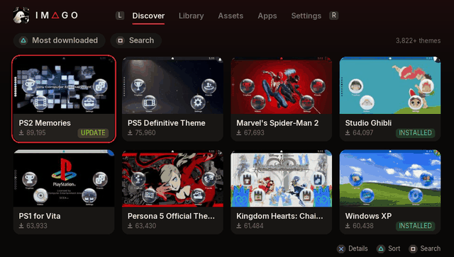
  <br>
  <sub>Real footage from the Vita3K emulator, at real speed (long pauses trimmed): the opening splash fades into the grid, a theme is opened and installed, its card gets an <b>INSTALLED</b> badge, and it shows up in the <b>Library</b>.</sub>
</p>

---

## ✨ What it does

| | |
|---|---|
| 🧭 **Endless browsing** | The whole repository in one grid. Pages load ahead of you as you scroll, so there's no page-flipping. Sort by newest, trending, popular, most downloaded, title or author. |
| 🔍 **Search, tags and authors** | Search with □. On any theme, tap a tag or *More by …* to filter the grid. ○ goes back to exactly where you were (same scroll, same theme highlighted) and SELECT jumps back to the start. |
| ⬇️ **Background installs** | Press Install and keep browsing. Installs queue up, and progress shows on the card, in the detail view and in the header. |
| 🔄 **Knows what's installed** | Cards are badged **INSTALLED**, **UPDATE** or **NEW**. Themes installed by Imago remember the exact version they came from, so updates are detected. |
| 📚 **Library** | Your themes in a grid. Uninstall (Imago tells you if the theme is in use, and asks about its pictures in Photos), remove from the system list but keep the files, re-add theme folders already on your card (one at a time or all at once), and check every theme for updates. |
| 🗂️ **Folders** | Sort your themes into your own folders (*Anime*, *Retro*, *Favourites*...): **✕ › Move to folder** on any theme. Folders show a preview of their first themes, and SELECT renames or deletes one. They're Imago's alone, so the system theme list is never touched. |
| 🎛️ **Customize any theme** | Pick which wallpapers to keep, switch the music and custom icons off, rename it, and save it as a new theme. The original stays untouched, and the previews are redrawn from your new first wallpaper. |
| 📚 **Asset library** | The **Assets** tab shows every wallpaper, icon set, song and lock screen across your installed themes. Preview them full screen, play the music right on the Vita, pick the parts you like (wallpapers from several themes, one page at a time), and press △ to turn them into a brand-new theme. |
| 🧪 **Mix themes** | In Theme Studio, press △ on any part (wallpapers, music, icons, lock screen, status bar) to take it from another installed theme. Every author whose parts you use is credited in the new theme. |
| 📸 **Your own pictures** | Screenshots, photos and any JPEG or PNG on your memory card can become wallpapers or the lock screen: from the **Pictures** shelf in Assets, or **Your pictures** in Theme Studio. Imago resizes them to the Vita's 960×512 and saves them in the 8-bit format themes use. |
| 🫧 **Restyle your apps** | The **Apps** tab changes any app's bubble icon, LiveArea background and start gate, from your own pictures or [artwork found online](#-online-artwork). Frame the picture with a live preview; a matching start gate can be cut from the background. The original artwork is backed up first, and one press puts it back. |
| 🌐 **Artwork from the web** | VitaDB, the PlayStation Store, SteamGridDB, IGDB, TheGamesDB and RAWG, searched from the app's page. Keys are typed or scanned from a QR code with the camera. |
| 💾 **Careful with the system** | Backs up the system theme list before changing it, checks it for damage first, and never deletes anything outside a `customtheme` folder. More below. |
| 🏞️ **Theme wallpapers in Photos** | Optional (*Settings › Theme wallpapers in Photos*): adds the wallpapers and lock screens of your installed themes to the Photos app, so you can pick them in the system's own page-wallpaper picker. Handy with plugins like [livearea_nolimits](https://github.com/devnoname120/livearea_nolimits), where themes only reach the first 10 home-screen pages. The first time can take a while with a large theme collection; after that only new themes are added. Turning it off can delete exactly the pictures Imago added. |
| 📂 **Install anywhere** | `ux0:`, `ur0:` or `uma0:`, using the same `customtheme` folders as Custom Themes Manager, so themes from either app show up in both. |
| 🎮 **Feels native** | D-pad, analog stick and touch (tap and drag). ○/✕ follow your console's confirm-button setting, and the PS button is locked only while the database is being written. |

<p align="center">
  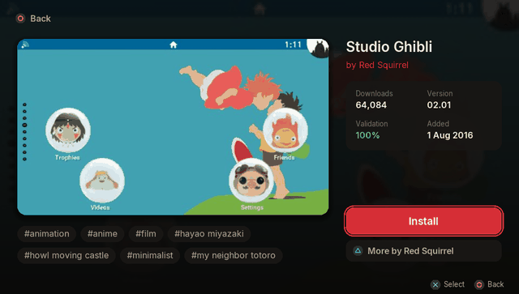
  <br>
  <sub>One press: <b>Downloading → Installing → Finishing</b>, then a reminder of where to apply it.</sub>
</p>

## 🖼️ A look at it

<table>
  <tr>
    <td width="50%"><br><sub><b>Discover</b>: the grid, with <b>INSTALLED</b> and <b>UPDATE</b> badges</sub></td>
    <td width="50%">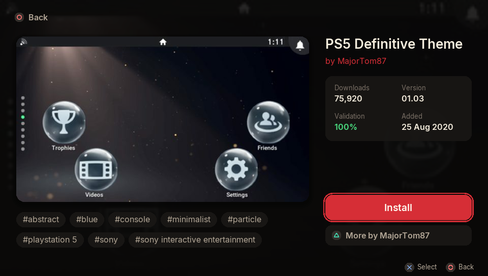<br><sub><b>Details</b>: big preview, stats and tags (each tag is a filter)</sub></td>
  </tr>
  <tr>
    <td>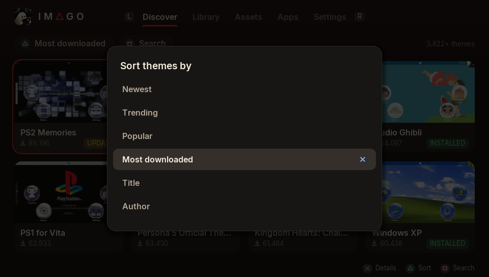<br><sub><b>Sort</b>: six orders, remembered between sessions</sub></td>
    <td>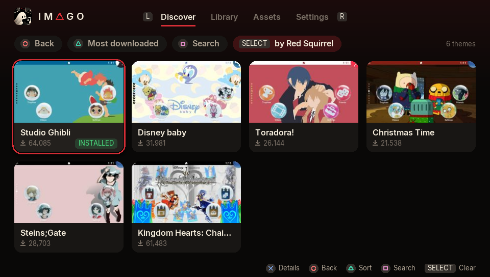<br><sub><b>More by author</b>: every theme by Red Squirrel, one press away</sub></td>
  </tr>
  <tr>
    <td>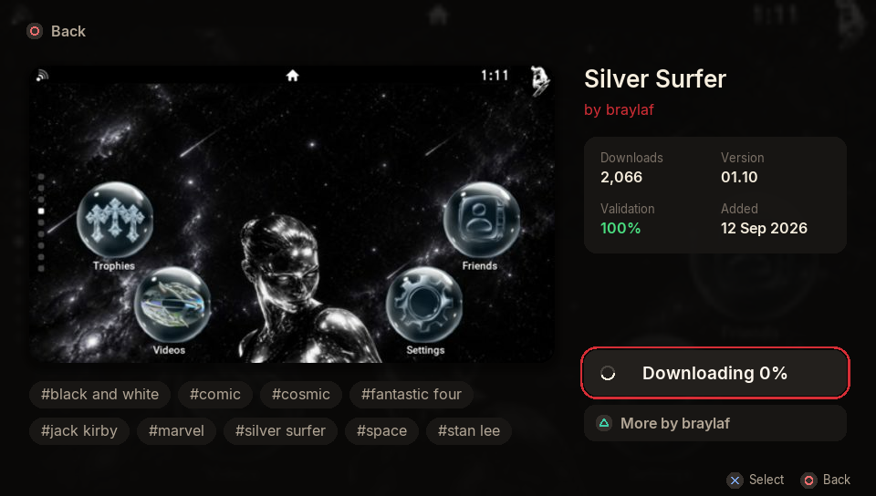<br><sub><b>Installing</b>: live progress on the button</sub></td>
    <td>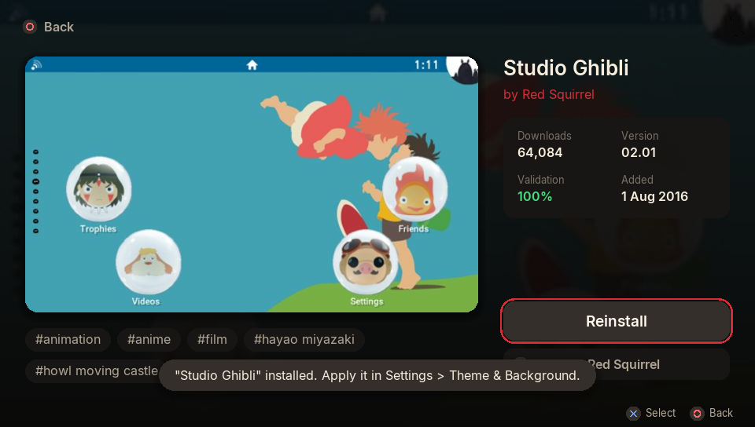<br><sub><b>Installed</b>: ready in Settings › Theme &amp; Background</sub></td>
  </tr>
  <tr>
    <td>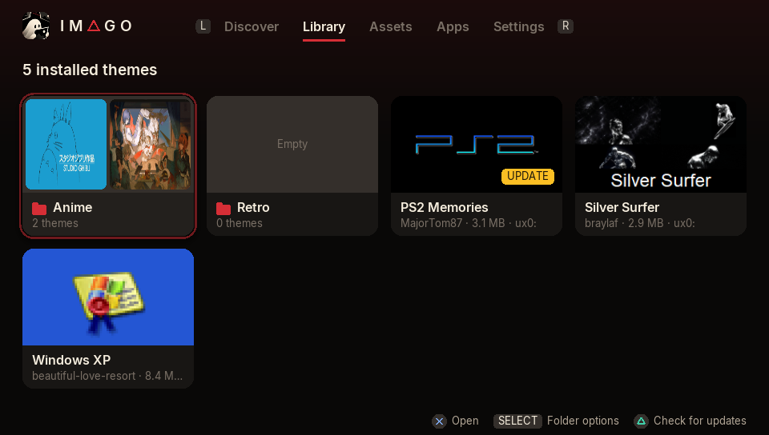<br><sub><b>Library</b>: your own folders, an <b>UPDATE</b> and a theme <b>NOT ADDED</b> yet</sub></td>
    <td>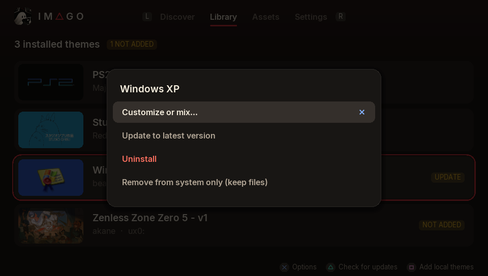<br><sub><b>Options</b>: update, uninstall, or remove from the system only</sub></td>
  </tr>
  <tr>
    <td>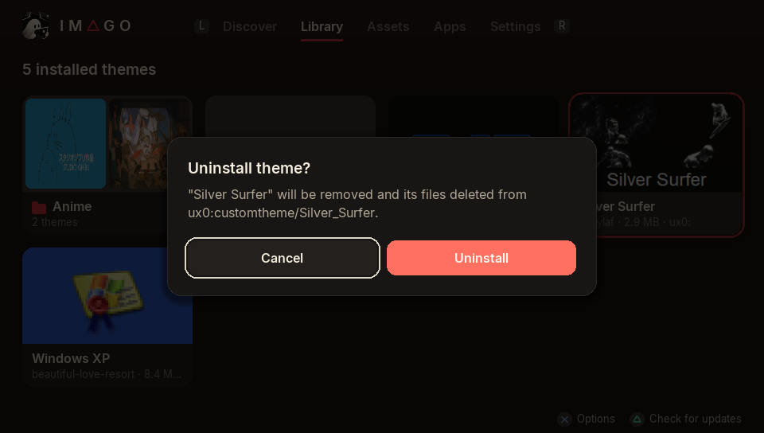<br><sub><b>Uninstall</b>: destructive actions default to Cancel</sub></td>
    <td>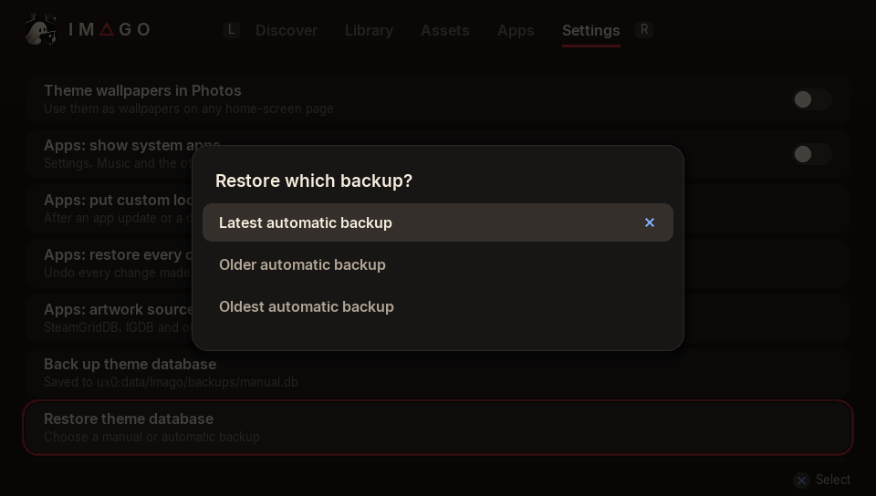<br><sub><b>Restore</b>: pick a manual or automatic backup</sub></td>
  </tr>
  <tr>
    <td>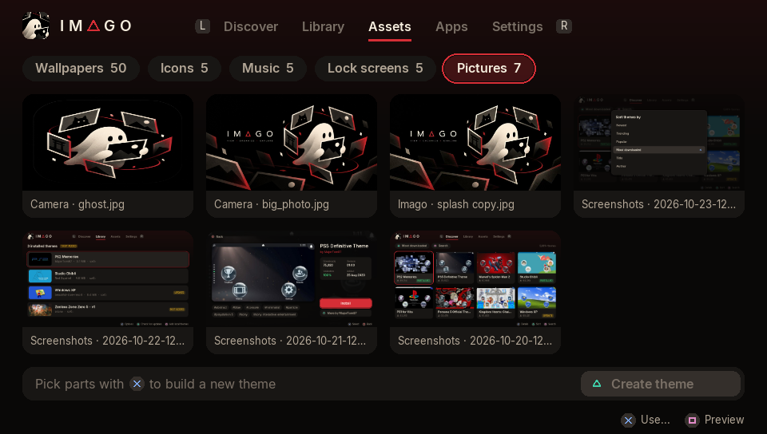<br><sub><b>Your pictures</b>: screenshots and photos as wallpapers or the lock screen</sub></td>
    <td>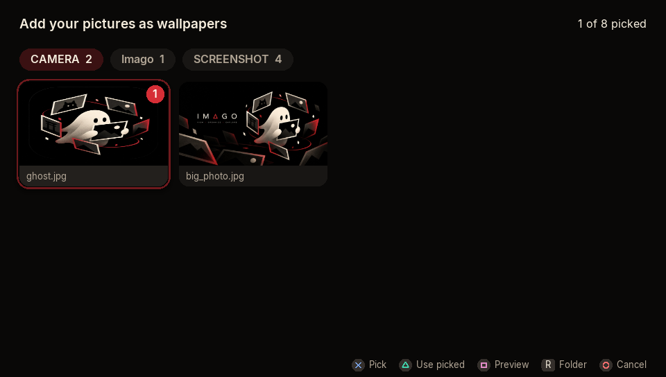<br><sub><b>Picture browser</b>: add pictures to any theme in Theme Studio</sub></td>
  </tr>
  <tr>
    <td>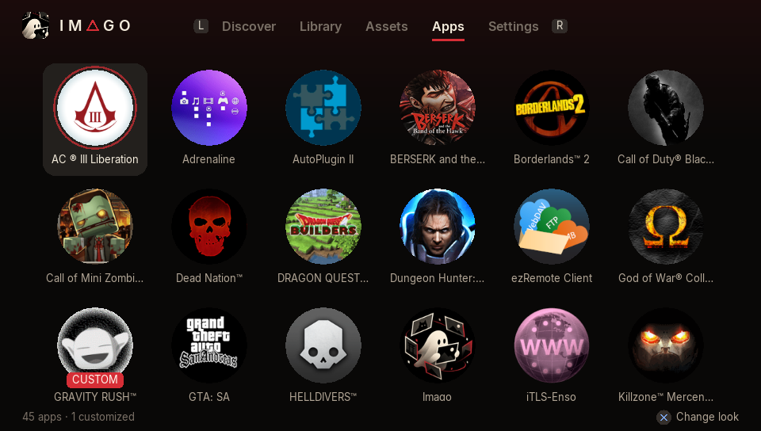<br><sub><b>Apps</b>: every app, with the ones you restyled marked <b>CUSTOM</b></sub></td>
    <td>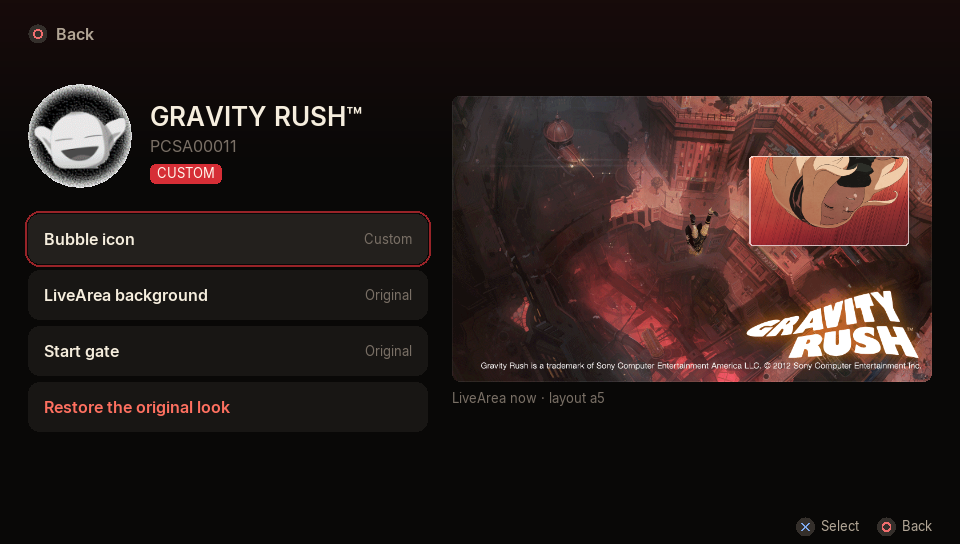<br><sub><b>An app</b>: bubble icon, LiveArea background and start gate</sub></td>
  </tr>
  <tr>
    <td>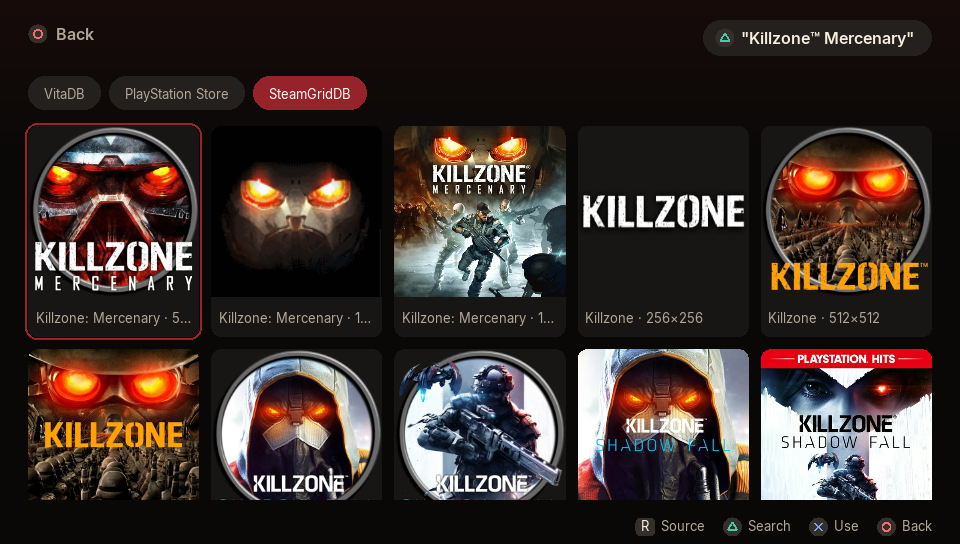<br><sub><b>Search online</b>: bubble icons from SteamGridDB</sub></td>
    <td>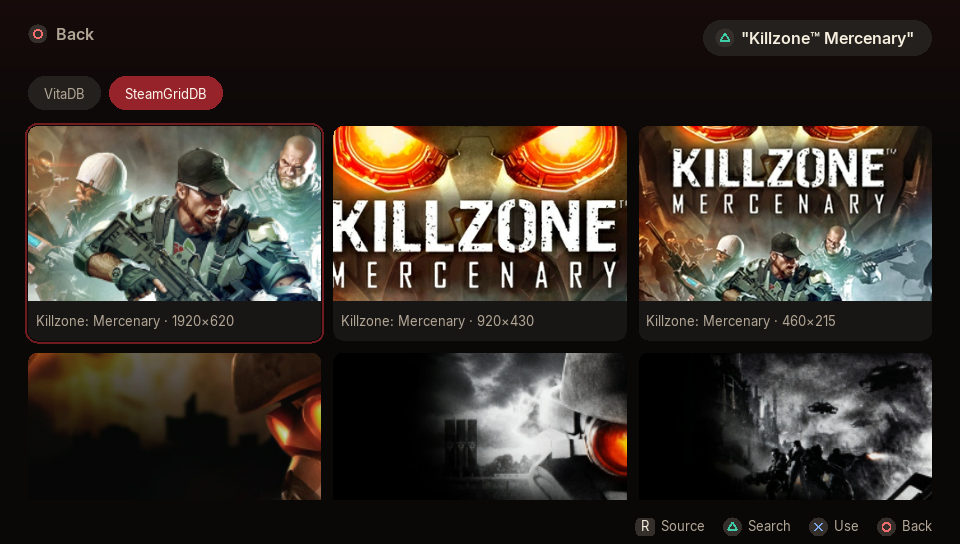<br><sub>…and wide pictures for the LiveArea background</sub></td>
  </tr>
  <tr>
    <td>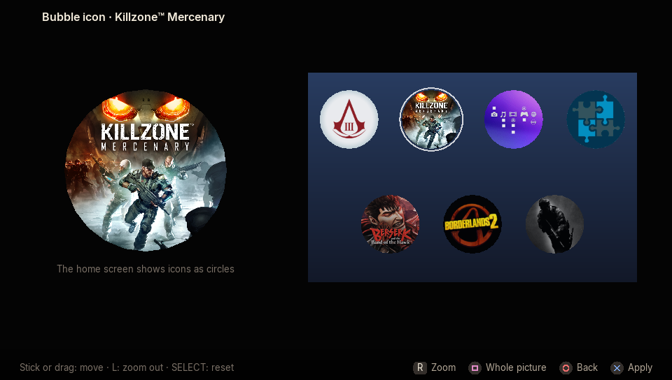<br><sub><b>Editor</b>: frame the picture, previewed on the home screen</sub></td>
    <td>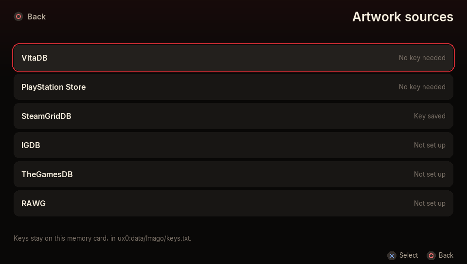<br><sub><b>Artwork sources</b>: add keys by typing or with a QR code</sub></td>
  </tr>
</table>

<sub>The theme screenshots are from the Vita3K emulator; the <b>UPDATE</b> and <b>NOT ADDED</b> states were set up by hand for the pictures. The Apps screenshots are from a real PS Vita. Everything else is the app as it runs.</sub>

## ⚡ Why it's fast

Measured on psvt.ovh's most downloaded themes:

| | Downloading the site as it is | What Imago downloads |
|---|---|---|
| **Grid thumbnails** | full-size PNG previews, median **~155 KB** each | resized JPEGs via [wsrv.nl](https://wsrv.nl), median **~7 KB**, cached on the memory card |
| **Opening a theme** | the whole page, median **~2.5 MB** (it embeds every image of the theme) | streamed and cut off as soon as the details arrive: median **~80 KB** |
| **List pages** | ~40 KB of HTML | gzip, ~10 KB |
| **Connections** | one per request | kept alive and reused by several workers in parallel |
| **While installing** | — | the grid stays fully usable; installs run on their own thread |

## 📦 Download

**[Imago v1.2.0](https://github.com/SevyW/imago/releases/tag/v1.2.0)**: the latest release. ([All releases](https://github.com/SevyW/imago/releases))

| File | Size | MD5 |
|---|---|---|
| `imago-v1.2.0.vpk` | 3.5 MB | `9e787c06c880b7a8049e264a76362a50` |

<details>
<summary>SHA-256 and how to check the file</summary>

```
SHA-256  b91e8c69d8c83120120fc433d4a8c13caf81443fa7960246aa48f29518c520ec
```

```bash
md5sum imago-v1.2.0.vpk                     # Linux / macOS / Git Bash
certutil -hashfile imago-v1.2.0.vpk MD5     # Windows
```

Each release's notes list what changed, what to test, and how to recover if something goes wrong.

</details>

## 🧭 How to use it

**You need:**

- A PS Vita running HENkaku, h-encore or Ensō. (A PS TV should work too, but hasn't been tried.)
- **Unsafe homebrew enabled.** Open HENkaku Settings (VitaShell or molecularShell, then START), turn on *Enable Unsafe Homebrew*, and reboot. Imago writes the system theme list in `ur0:shell/db/app.db`. Without unsafe homebrew you can still browse, and the Library reminds you how to turn it on.
- Wi-Fi.

**Then:**

1. Download the `.vpk` from [the latest release](https://github.com/SevyW/imago/releases/latest), install it with VitaShell and launch **Imago** from the LiveArea.
2. Find a theme you like and press **✕ → Install**.
3. Apply it in **Settings › Theme & Background**. If it doesn't show up there, use *Restart PS Vita* in Imago's settings.

### Controls

| Button | Discover | Theme details | Library |
|---|---|---|---|
| ✕ | Open theme | Activate | Theme options · open a folder |
| ○ | Back to the previous grid | Back | Out of a folder |
| △ | Sort | More by this author | Check for updates |
| □ | Search | — | Add local themes |
| SELECT | Back to the start | — | Rename or delete a folder |
| L / R | Switch tabs | | |

**Assets tab:** ✕ pick (on a picture: use it as a wallpaper or the lock screen) · □ preview (play / stop for music) · △ create a theme from the picks · SELECT clear the picks. **Theme Studio:** ✕ change · △ take this part from another theme or from your pictures · ○ back. **Choosing pictures:** L / R switch folders · ✕ pick · □ preview · △ use the picked pictures.

**Apps tab:** ✕ open an app, then ✕ on a part: *From the memory card*, *Search online* or *Back to the original*. **Search online:** L / R switch sites · △ change what's searched · ✕ use the picture. **Editor:** stick or drag to move · R / L zoom · □ whole picture · △ seamless start gate (backgrounds) · SELECT reset · ✕ apply.

**Where Imago finds pictures:** everything in the Photos app's folder (`ux0:picture`, where screenshots go) and in `ux0:data/Imago/pictures`, which Imago creates for pictures you copy from a PC with VitaShell.

On Japanese consoles ✕ and ○ are swapped, as the system does. Touch works everywhere: tap to open, drag to scroll.

## 🫧 Restyle your apps

Every app has three pictures the system shows: its **bubble icon** on the home screen, and the **background** and **start gate** of its LiveArea. The **Apps** tab changes any of them, for games and homebrew alike.

1. Open an app, choose a part, then **From the memory card** or **Search online**.
2. Frame the picture in the editor. Bubble icons are previewed among your other bubbles; backgrounds are previewed as the LiveArea, and the start gate can be cut from the same picture so the two line up seamlessly.
3. Press ✕. Imago scales the picture to the exact size the app uses, reduces it to the 256 colours the system expects, and puts it in place. LiveArea changes show straight away; a new bubble icon shows after a restart (Imago offers one).

The original artwork is backed up before the first change, and *Restore the original look* puts it back (see *Built to keep your Vita safe* below). After an app update, *needs reapplying* puts your look back in one press.

### 🌐 Online artwork

Choose a part of an app, then **Search online**. The search starts with the app's name (△ changes it), and each site has its own tab. Pick a picture and Imago downloads it and opens it in the editor.

| Source | What it has | Key |
|---|---|---|
| [VitaDB](https://www.rinnegatamante.eu/vitadb/) | Homebrew icons and screenshots, matched by the app's title ID | None |
| PlayStation Store | Official icons of retail games | None |
| [SteamGridDB](https://www.steamgriddb.com) | Icons, square grids, wide banners | Free: sign in, then [Preferences › API](https://www.steamgriddb.com/profile/preferences/api) |
| [IGDB](https://www.igdb.com) | Covers, artworks, screenshots | Free, through Twitch: turn on two-factor authentication, register an app at [dev.twitch.tv/console/apps](https://dev.twitch.tv/console/apps) (redirect URL `http://localhost`, client type *Confidential*), then copy its Client ID and make a Client Secret |
| [TheGamesDB](https://thegamesdb.net) | Box art, fanart, banners, screenshots | Free: make an account and [request a key](https://api.thegamesdb.net/key.php). Searches use part of a monthly allowance |
| [RAWG](https://rawg.io) | Backgrounds and screenshots | Free for personal use: [Get API Key](https://rawg.io/apidocs) |

> [!NOTE]
> VitaDB, the PlayStation Store and SteamGridDB are tested on a real PS Vita. **IGDB, TheGamesDB and RAWG are written to their documentation but haven't been tried with real keys yet.** If you use one, please [tell us how it went](https://github.com/SevyW/imago/issues). The PlayStation Store's search isn't a public API, so it may stop working one day.

#### Adding a key

In *Settings › Apps: artwork sources*, choose the site, then **Type the key** or **Scan a QR code**. The scanner uses the back camera; press □ to switch to the front one. Imago tests the connection right away, and **Test the connection** checks it again any time. Keys stay on your memory card in `ux0:data/Imago/keys.txt` and never appear in the log.

#### Making a QR code

A QR code saves typing a long key on the Vita. We recommend [inyourbrowser.com's text-to-QR generator](https://www.inyourbrowser.com/qr-code-generator/text-to-qr): it makes the code inside your browser, without sending what you type to a server. Avoid generators that make the code on their server, since they see your key. Put either the bare key in the code, or one `name=value` per line to set up several sites in one scan:

```
steamgriddb=YOUR_STEAMGRIDDB_KEY
igdb_id=YOUR_TWITCH_CLIENT_ID
igdb_secret=YOUR_TWITCH_CLIENT_SECRET
thegamesdb=YOUR_THEGAMESDB_KEY
rawg=YOUR_RAWG_KEY
```

## 🛡️ Built to keep your Vita safe

Changing `app.db` is the one risky thing a theme manager does. Imago treats it that way:

- **Backups before any change.** Before its first change in a session, Imago checks the database for damage and saves a copy. It keeps the last three automatic backups plus your manual one, so a bad session can never overwrite every good copy.
- **Never edits a database that's in use.** If the system is in the middle of writing its theme list, Imago waits instead of writing at the same time.
- **Restores by swapping files, never by overwriting.** A restored backup is checked first, staged next to `app.db` and swapped in by renaming, and the previous file is put back if anything fails.
- **Updates can't leave a theme half-installed.** New files are extracted and CRC-checked in a staging folder, the old version is moved aside, and everything rolls back if any step fails.
- **Deletes only what it should.** Files are removed only from a single folder directly inside `customtheme`, and only after the system list confirms the theme was there.
- **Untrusted downloads are bounded.** Paths are sanitised, archives can't inflate past their declared size, downloads are size-capped, and free space is checked against the real unpacked size first.
- **One short transaction per change.** Writes use bound parameters (titles with apostrophes are fine) and adapt to the firmware's table layout instead of assuming it.

The Apps tab changes the system's copy of each app's artwork (`ur0:appmeta`), so it's just as careful:

- **The original comes first.** Before an app's first change, its whole artwork folder is copied to `ux0:data/Imago/apps/<TITLEID>/original`, with a checksum of every file. Your pictures are saved next to it.
- **Only that app's own artwork folder is written**, and every new file is copied next to the old one, checked, then swapped in by renaming, with the old file put back if the swap fails.
- **App updates are expected.** If an update or a database rebuild replaces your artwork, the app shows *needs reapplying*; reapplying keeps the older originals in `history/` and backs up the new ones before putting your look back.
- **One press undoes it.** *Restore the original look* (per app, or every app from Settings) puts the original files back; the backups stay on the memory card.
- **Keys stay private.** API keys live only in `ux0:data/Imago/keys.txt`, and they never appear in the log or the address of a logged download.

## ⚙️ How it works

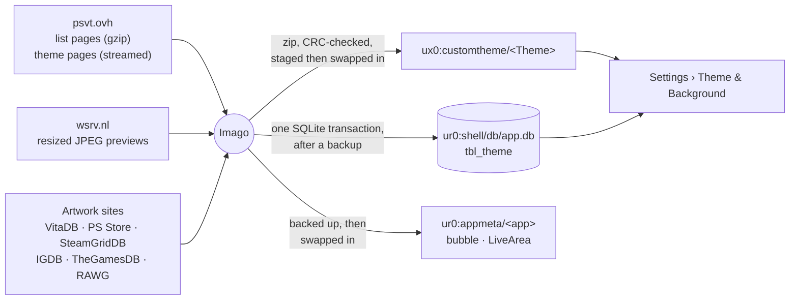

- **No API, just HTML.** psvt.ovh has no API, so Imago reads its list pages (20-odd themes each) and stops reading a theme's page as soon as the details have arrived.
- **Threads.** Rendering never waits on the network. Two job workers load pages, three image workers fetch and decode thumbnails, and a dedicated thread runs installs one at a time.
- **Its own SQLite.** SQLite 3.54 is built into the app with a small file-system layer for the Vita, rather than relying on the firmware's copy.

## 🎨 Make themes yours

Imago doesn't stop at installing themes: it lets you **make them yours**. Every Vita theme is a folder of images and sounds wired together by one `theme.xml`. Its parts are what the three tools below work with:

| Part | What a theme can set |
|---|---|
| 🖼️ **Home wallpapers** | Up to 10 pages, each with a picture, a thumbnail, a wave style and a font colour |
| 🎵 **Background music** | One `.at9` track that plays on the home screen |
| 🧩 **App icons** | Custom icons for up to 20 system apps (Browser, Music, Settings, Trophies…) |
| 🔒 **Lock screen** | A picture, plus the colours of the clock and notifications |
| 📶 **Status bar** | Bar and indicator colours, and the notification icons |

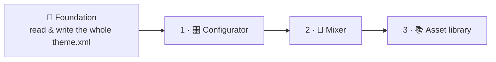

### 1 · 🎛️ Theme configurator · ✅ in v1.0

*Turn parts of a theme on and off.* Library › Options › **Customize…**

- Toggle the **background music** and the **custom icons** (back to the system ones).
- Pick which **wallpapers** to keep.
- Changes are saved as a new copy (*Studio Ghibli · custom*), so the original download stays untouched and updates still work.

### 2 · 🧪 Theme mixer · ✅ in v1.0

*Take parts from one theme and put them in another.* In Theme Studio, press △ on a part.

- Start from a theme, then pull in pieces from any other installed one: *these wallpapers, that music, those icons*.
- The mixer copies the files into a new theme folder, writes a fresh `theme.xml` and previews, and adds the result to your themes.
- Each part shows where it came from, and the new theme credits every author whose parts it uses.

### 3 · 📚 Asset library · ✅ in v1.0

*Every wallpaper, icon and song you own, in one place.* The **Assets** tab.

- Imago indexes all installed themes and shows their parts as shelves: **Wallpapers**, **Icons**, **Music**, **Lock screens**, plus a **Pictures** shelf with your own screenshots and photos.
- Preview everything before using it: full-screen wallpapers, icon sets side by side, and music played right on the Vita.
- Build a **brand-new theme** by picking parts from the shelves; it uses the same machinery as the mixer.

**Ground rules for all three:** never modify a downloaded theme in place, always produce a new theme folder, keep every write to the system theme list behind the same backups and checks as installs, and credit the original authors in the new theme's details.

## 🗂️ Project layout

| Path | What's in it |
|---|---|
| [`src/`](src/) | The app (C). `psvt.c` reads the site, `tasks.c` installs and builds themes, `themedb.c` handles the system theme list, `unzip.c` extracts, `themedoc.c` reads and rewrites `theme.xml`, `assets.c` indexes the asset library, `pictures.c` finds your pictures and `imageio.c` turns them into theme images, `folders.c` keeps your Library folders, `music.c` plays ATRAC9 music, and `ui.c` plus the `screen_*.c` files draw the interface. For apps: `appdb.c` and `apps.c` list them, `store.c` backs up and rewrites their artwork, `edit.c` and `quant.c` turn pictures into their images, `artwork.c` searches the artwork sites, `keys.c` keeps the API keys and `qrscan.c` reads QR codes. |
| [`tests/`](tests/) | Unit tests that run on a PC: site parsing, zip extraction, theme files, the database layer, and the Apps tab's backups and image conversion. |
| [`assets/brand/`](assets/brand/) | The source artwork by Sevy: the ghost icon and the IMAGO key art. |
| [`tools/`](tools/) | Scripts that generate the app's artwork from `assets/brand/` and this README's hero image (from a public-domain PS Vita photo in `tools/assets/`). |
| [`assets/`](assets/) | The Inter typeface (SIL Open Font License). |
| [`third_party/`](third_party/) | The SQLite amalgamation (public domain), [cJSON](https://github.com/DaveGamble/cJSON) (MIT) and [quirc](https://github.com/dlbeer/quirc) (ISC). |
| [`docs/images/`](docs/images/) | Screenshots and recordings used here. |

## 🚀 Building

**You need:** [VitaSDK](https://vitasdk.org) and its packages. Use the toolchain that matches your `vdpm` package channel; a mismatched one builds fine but can break at runtime.

```sh
vdpm install libvita2d curl openssl-1.1.1 zlib
cmake -S . -B build -G Ninja
cmake --build build            # → build/Imago.vpk
```

For emulator testing, configure a second build with `-DIMAGO_AUTOPILOT=ON`. It replays `<frame> <BUTTON>` lines from `ux0:data/Imago/autopilot.txt`, so screens can be scripted without anyone at the keyboard. To exercise the full install path in Vita3K, put a mock `app.db` in its `ur0:shell/db/`.

The bubble, LiveArea, splash and header logo are generated from `assets/brand/` with `python tools/make_brand.py`, and the hero image with `python tools/make_hero.py` (both need Pillow).

## 🧪 Checks

The parts that can hurt a console are tested on a PC with any C11 compiler (these commands use `zig cc`):

| Test | Checks |
|---|---|
| `tests/test_psvt.c` | Parsing real list and theme pages: titles, hashes, downloads, tags, scores, dates; URL encoding; HTML entities |
| `tests/test_install.c` | Extracting a real 6.7 MB theme and a nested zip; CRC checks; progress and cancel; skipping `../` and macOS junk; `theme.xml`; folder-name and path validation |
| `tests/test_themedoc.c` | Reading, editing and rebuilding 16 real themes from four different theme tools; toggling music, icons and pages; mixing every part between themes; building a theme from single pages of several themes; lock screen images; themes made from pictures, and pictures mixed into a theme (960×512 and 360×192 8-bit PNGs, odd file names, a file that isn't a picture); regenerated previews; dropping dangling icons; refusing `../` file references; parsing every theme's ATRAC9 music |
| `tests/test_folders.c` | Creating, renaming and deleting folders; unique names; moving themes in and out; surviving a reload; the 32-folder limit; a damaged folders file |
| `tests/test_themedb.c` | Writing `tbl_theme` on a mock schema; localized columns; apostrophes; trailing-slash ids; names stored as UTF-16 by the system (accents, symbols, emoji); the live-journal guard; backup and restore round trip; refusing a damaged backup without touching `app.db` |
| `tests/test_core.c` | Reading LiveArea templates and `param.sfo`; reducing pictures to 256 colours |
| `tests/test_store.c` | Backing up an app's artwork, applying, noticing replaced files, reapplying after an update (older originals kept), and restoring, on a mock `ur0:appmeta` |

```sh
zig cc -std=c11 -o test_psvt tests/test_psvt.c src/psvt.c && ./test_psvt list.html theme.html
zig cc -std=c11 -I<zlib> -o test_install tests/test_install.c src/unzip.c src/fs.c src/theme.c src/psvt.c \
  <zlib>/{adler32,crc32,inflate,inftrees,inffast,zutil}.c && ./test_install theme.zip nested.zip scratch/
zig cc -std=c11 -DAPP_DB_PATH='"scratch/app.db"' -Ithird_party/sqlite -o test_themedb tests/test_themedb.c \
  src/themedb.c src/dbtext.c src/fs.c src/theme.c src/psvt.c third_party/sqlite/sqlite3.c && ./test_themedb
zig cc -std=c11 -I<libpng> -I<zlib> -o test_themedoc tests/test_themedoc.c tests/jpeg_stub.c src/themedoc.c \
  src/xmltree.c src/imageio.c src/fs.c src/theme.c src/psvt.c src/at9.c src/unzip.c <libpng and zlib sources> \
  && ./test_themedoc scratch/ theme1.zip theme2.zip theme3.zip
zig cc -std=c11 -I<libpng> -I<zlib> -o test_core tests/test_core.c src/livearea.c src/quant.c src/sfo.c \
  src/xmltree.c src/fs.c src/psvt.c <libpng and zlib sources> && ./test_core
zig cc -std=c11 -I<libpng> -I<zlib> -Ithird_party/sqlite -DAPPMETA_DIR='"scratch/appmeta"' -DDATA_DIR='"scratch/data"' \
  -DAPP_DB_PATH='"scratch/store.db"' -o test_store tests/test_store.c src/store.c src/appdb.c src/dbtext.c \
  src/livearea.c src/sfo.c src/xmltree.c src/fs.c src/imageio.c tests/jpeg_stub.c src/quant.c src/psvt.c \
  third_party/sqlite/sqlite3.c <libpng and zlib sources> && ./test_store
zig cc -std=c11 -DFOLDERS_FILE='"scratch/folders.txt"' -o test_folders tests/test_folders.c src/folders.c \
  src/fs.c && ./test_folders
```


## 🐞 Something not working?

Please [open an issue](https://github.com/SevyW/imago/issues/new?template=bug_report.yml) and attach Imago's log, which is what makes a problem fixable:

1. In VitaShell, copy `ux0:data/Imago/log.txt` to your PC (over USB, or FTP from VitaShell's START menu). If there's also a `log-previous.txt`, take that too.
2. Say what you were doing when it happened, and drag the files into the issue.

The log lists what Imago did (the screens you visited, installs and saves with their results, any errors), with your Imago version and firmware at the top. It never contains anything personal. *Settings › Report a problem* in the app shows the same steps.

## ☕ Support

Imago is free and always will be. If it made your Vita a little more yours, you can [buy me a coffee on Ko-fi](https://ko-fi.com/sevyw). It's never expected, always appreciated. And please consider [supporting psvt.ovh](https://gofund.me/e8f1d6c4) too: it's where all these themes live.

## 🙏 Credits

- **Imago**, the ghost and the IMAGO key art: created by [Sevy (@SevyW)](https://github.com/SevyW). The Apps tab began as *Pictura*, Sevy's app-artwork editor, merged into Imago in 1.3.
- **Themes and the repository:** [psvt.ovh](https://psvt.ovh) by Red Squirrel, who also wrote Custom Themes Manager. The site runs on donations, so please consider [supporting it](https://gofund.me/e8f1d6c4).
- **[Inter](https://rsms.me/inter/)** typeface by Rasmus Andersson (SIL Open Font License).
- **[SQLite](https://sqlite.org)**, **[libvita2d](https://github.com/xerpi/libvita2d)**, **[curl](https://curl.se)**, **zlib**, **libpng** and **libjpeg-turbo**, via [VitaSDK](https://vitasdk.org).
- **[cJSON](https://github.com/DaveGamble/cJSON)** by Dave Gamble (MIT) and **[quirc](https://github.com/dlbeer/quirc)** QR decoding by Daniel Beer (ISC).
- **Online artwork** from [VitaDB](https://www.rinnegatamante.eu/vitadb/) by Rinnegatamante, [SteamGridDB](https://www.steamgriddb.com), [IGDB](https://www.igdb.com), [TheGamesDB](https://thegamesdb.net), [RAWG](https://rawg.io) and the PlayStation Store. The pictures belong to their creators and publishers.
- **Thumbnail resizing** by [wsrv.nl](https://wsrv.nl).
- **PS Vita photo** in the header by [Evan-Amos](https://commons.wikimedia.org/wiki/File:PlayStation-Vita-1101-FL.png) (public domain); the screen shows real Imago screenshots.
- **The `tbl_theme` layout** follows vitasdk's `psp2/lsdb.h` notes and the open-source [Tema](https://github.com/xamthor/Tema) installer.

## 📄 License

Imago is released under the [MIT License](LICENSE), © 2026 Sevy (@SevyW). The bundled Inter typeface is under the SIL Open Font License, cJSON under the MIT License, quirc under the ISC License, and SQLite and the PS Vita photo are in the public domain.
